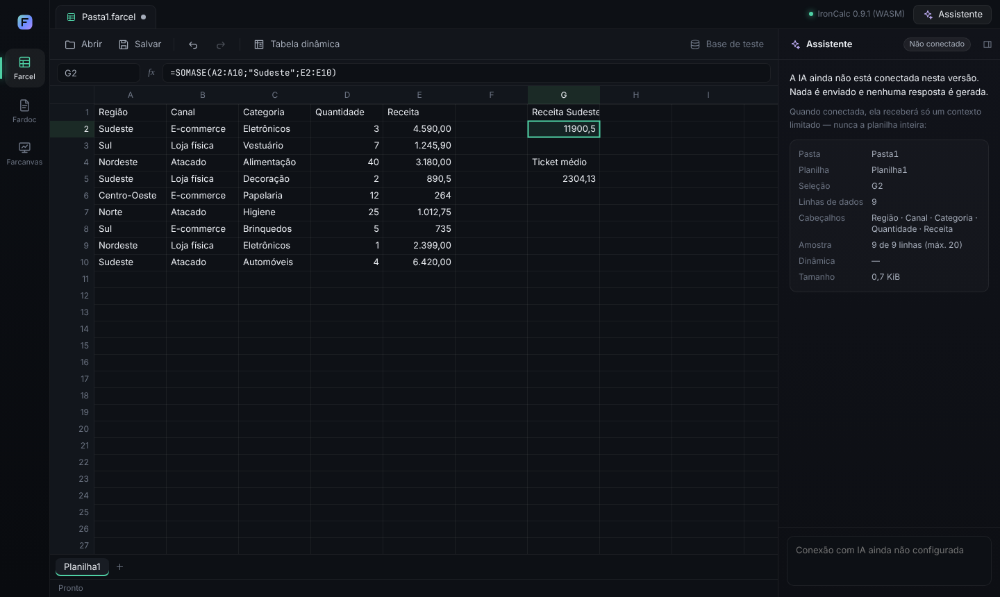
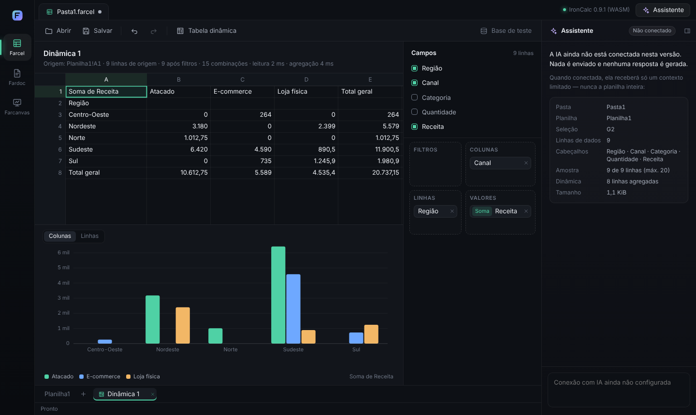

# Farihub

Ambiente de trabalho Fariv: **Farcel** (planilhas), **Fardoc** (documentos) e **Farcanvas** (apresentações), com IA integrada.

## Decisões do produto

- Windows primeiro; núcleo compartilhável com web e mobile.
- Arquivos locais e edição offline; IA conectada.
- Interface minimalista com seletor lateral, abas e assistente contextual. Referência visual aprovada na conversa de 29/10/2026.
- Farcel: tabela dinâmica, gráficos, fórmulas familiares ao Excel em português e objetivo de 1.000.000 de linhas por aba.
- Implementação própria com componentes reutilizáveis sem licença paga de motor.
- Contas, sincronização e colaboração ficam para depois.

## Estado

Primeira versão funcional do **Farcel no navegador**:

- grade em canvas com edição, acentos, navegação por teclado, copiar/colar tabular, desfazer e barra de fórmulas;
- cálculo real no **IronCalc 0.9.1 (WASM) dentro de um Web Worker**, fonte única da verdade;
- fórmulas em português (`=SOMA(A1:A3)`, `=SE(A1>0;"sim";"não")`, `1,5`) por uma camada de tokens;
- tabela dinâmica com linhas, colunas, valores (soma, contagem) e filtros, e gráfico ligado ao resultado;
- salvar e abrir **`.farcel`** (formato próprio; não é XLSX);
- base sintética reprodutível de 1.000.000 de linhas, medida na interface.

Fardoc e Farcanvas aparecem como espaços **em preparação**. O assistente aparece **não conectado**: mostra o contexto limitado que receberia, sem enviar nada nem simular respostas. Não há executável Windows, importação/exportação XLSX nem comparação com o Microsoft Excel.




## Executar

Requer Node.js 24.22.1 ou superior (CI). Também testado localmente com Node 22.22.

```sh
npm ci
npm run dev          # http://localhost:5173 — desenvolvimento
npm run build        # gera dist/
npm run preview      # serve dist/ em http://localhost:4173
```

No Farcel: digite nas células ou na barra de fórmulas, cole dados do Excel/Planilhas (Ctrl+V), use **Tabela dinâmica** para criar uma dinâmica a partir de A1 da planilha atual e **Base de teste** para gerar a base de 1.000.000 de linhas (cerca de 25 s, substitui a pasta atual). **Salvar** (Ctrl+S) grava `.farcel`; **Abrir** (Ctrl+O) lê `.farcel`.

## Testes e medições

```sh
npm run typecheck
npm test                     # núcleo e motor (Node, mesmo WASM do navegador)
npm run build && npm run test:e2e   # fluxos no Chromium (Playwright)
npm run bench:browser        # 1.000.000 de linhas na interface → reports/browser-million.json
node scripts/bench-wasm-formulas.ts  # 1 M fórmulas por linha no WASM (Node)
node scripts/screenshots.ts --million  # capturas em docs/screenshots/
```

`test:e2e` precisa de um Chromium para o Playwright (`npx playwright install chromium` se não houver).

Prova técnica anterior (agregação colunar e IronCalc nativo no Node), ainda disponível:

```sh
npm run bench
npm run probe:ironcalc
npm run bench:ironcalc
```

## Documentos

- [Arquitetura e escolhas do Farcel](docs/farcel-arquitetura.md) — fonte da verdade, worker, grade, fórmulas pt-BR, dinâmica, arquivo, limitações.
- [Resultados no navegador](docs/resultados-navegador.md) — 1.000.000 de linhas: tempos, memória, ambiente.
- [Escopo da prova técnica](docs/prova-tecnica.md) e [resultados iniciais](docs/resultados-iniciais.md).
