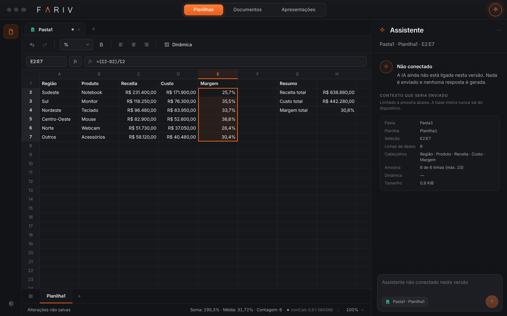
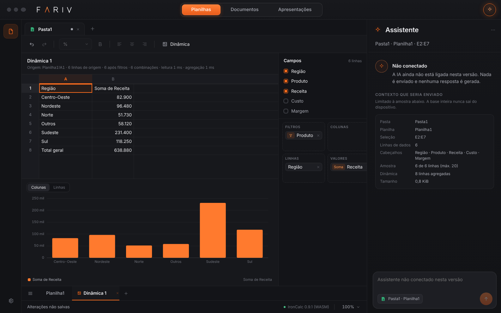

# Farihub

Ambiente de trabalho Fariv com três espaços — **Planilhas**, **Documentos** e **Apresentações** — e um assistente integrado.

Nomes internos: no código os espaços continuam `farcel`, `fardoc` e `farcanvas`, e o arquivo de planilha continua com a extensão `.farcel`. Na interface aparecem só os nomes visíveis acima.

## Decisões do produto

- Windows primeiro; núcleo compartilhável com web e mobile.
- Arquivos locais e edição offline; IA conectada.
- Interface minimalista com seletor de espaços, abas e assistente contextual (ver Direção visual).
- Planilhas: tabela dinâmica, gráficos, fórmulas familiares ao Excel em português e objetivo de 1.000.000 de linhas por aba.
- Implementação própria com componentes reutilizáveis sem licença paga de motor.
- Contas, sincronização e colaboração ficam para depois.

## Direção visual

Referências aprovadas em 30/10/2026 para Planilhas, Documentos e Apresentações. A interface aplica:

- aspecto de aplicativo de Mac: três bolinhas de janela à esquerda, barra de título compacta, superfícies grafite em camadas e divisórias discretas;
- assinatura Fariv com o A aberto em laranja (`src/app/shell/Wordmark.tsx`; recurso vetorial sem fundo em `src/app/assets/fariv-assinatura.svg`);
- seletor dos três espaços centralizado no topo; trilho lateral estreito (arquivos e ajustes); abas de pastas; área de trabalho ampla;
- laranja Fariv só em estados ativos e ações principais, com brilho contido;
- assistente à direita, recolhível e com largura ajustável (arraste a borda ou use as setas sobre ela);
- fonte Inter empacotada no app (funciona offline).

No navegador as bolinhas aparecem apagadas e não clicáveis: não existe janela nativa para controlar. O componente `WindowControls` recebe as ações reais quando o executável fornecer `window.farivWindow`.



## Estado

Primeira versão funcional de **Planilhas no navegador**:

- grade em canvas com edição, acentos, navegação por teclado, copiar/colar tabular, desfazer, zoom e barra de fórmulas com menu de funções;
- formatação de número (Geral, Número, Moeda R$, Porcentagem, Data), negrito e alinhamento, salvos no arquivo;
- várias pastas abertas em abas, cada uma com seu próprio motor; trocar de espaço não perde nada;
- cálculo real no **IronCalc 0.9.1 (WASM) dentro de um Web Worker**, fonte única da verdade;
- fórmulas em português (`=SOMA(A1:A3)`, `=SE(A1>0;"sim";"não")`, `1,5`) por uma camada de tokens;
- **operações de tabela**: filtros na grade (botões no cabeçalho, valores com contagem e busca), ordenação por uma ou várias colunas mantendo os registros juntos, inserir e excluir linhas e colunas com as referências atualizadas em todas as planilhas, cada uma com desfazer e refazer, por uma API tipada que a IA vai usar ([detalhes](docs/tabela.md));
- tabela dinâmica com linhas, colunas, valores (soma, contagem) e filtros, e gráfico ligado ao resultado (sempre sobre a base inteira, inclusive linhas ocultas pelo filtro da grade);
- **salvar por formato**: Ctrl+S mantém o formato do arquivo aberto (`.xlsx` continua `.xlsx`); pasta nova oferece XLSX como padrão e `.farcel` (nativo, guarda também dinâmicas, gráficos e as ressalvas de importação) como alternativa; **Salvar como…**; perdas explicadas antes, com escolha; no navegador sem acesso a arquivos, o app diz que está baixando uma cópia;
- **abrir e exportar XLSX** com o importador/exportador do próprio IronCalc compilado para WASM: fórmulas continuam fórmulas (em português na tela, em inglês no arquivo), várias planilhas, tipos e formatação básica; o app informa o que não é mantido e pede confirmação antes de exportar com perdas;
- **importar CSV, TSV e TXT** com prévia (codificação, separador, decimal, cabeçalho, tipo por coluna; códigos com zeros à esquerda preservados) e **exportar CSV (;) e TSV** “para abrir em planilhas” (texto que viraria fórmula recebe `'`) ou com os dados originais;
- base sintética reprodutível de 1.000.000 de linhas, medida na interface.

Documentos e Apresentações aparecem como espaços **em preparação** (as referências orientam o design futuro; não há editor). O assistente aparece **não conectado**: mostra o contexto limitado que receberia, sem enviar nada nem simular respostas. Não há executável Windows. Os XLSX exportados foram verificados no LibreOffice Calc (que recalculou todas as fórmulas); **não houve verificação no Microsoft Excel**, indisponível neste ambiente.

O que existe, o que é parcial e o que está planejado: [roadmap do produto](docs/roadmap-produto.md).



## Executar

Requer Node.js 24.22.1 ou superior (CI). Também testado localmente com Node 22.22.

```sh
npm ci
npm run dev          # http://localhost:5173 — desenvolvimento
npm run build        # gera dist/
npm run preview      # serve dist/ em http://localhost:4173
```

Para experimentar em **Planilhas**:

1. Digite nas células ou na barra de fórmulas (`=SOMA(A1:A3)`, `=SE(A1>0;"sim";"não")`), ou cole dados do Excel (Ctrl+V).
2. Formate pela barra: formato de número (R$, %), **B**, alinhamento. O botão *fx* insere funções em português.
3. Botão direito numa célula ou num cabeçalho: inserir/excluir linhas e colunas, ordenar, filtrar. Ctrl+Shift+L liga o filtro da tabela da seleção; os botões no cabeçalho filtram e ordenam.
4. **Dinâmica** cria uma tabela dinâmica a partir de A1 da planilha atual; arraste campos para Linhas, Colunas, Valores e Filtros. O gráfico fica abaixo.
5. No trilho à esquerda, o ícone de arquivos tem **Nova planilha**, **Abrir…** (Ctrl+O: `.farcel`, `.xlsx`, `.csv`, `.tsv`, `.txt`), **Salvar** (Ctrl+S, no formato do arquivo; pasta nova pergunta, com XLSX como padrão), **Salvar como…** (Ctrl+Shift+S), **Exportar planilha como CSV** e **TSV**, e **Base de teste…**, que gera 1.000.000 de linhas em uma aba nova (cerca de 25 s). Um arquivo aberto entra numa aba nova quando a atual já tem conteúdo.
6. O ✦ no canto superior direito mostra ou recolhe o assistente (ainda não conectado).

## Testes e medições

```sh
npm run typecheck
npm test                     # núcleo e motor (Node, mesmo WASM do navegador)
npm run build && npm run test:e2e   # fluxos no Chromium (Playwright)
npm run bench:browser        # 1.000.000 de linhas na interface → reports/browser-million.json
node scripts/bench-wasm-formulas.ts  # 1 M fórmulas por linha no WASM (Node)
node scripts/screenshots.ts --million  # capturas em docs/screenshots/
node scripts/bench-xlsx.ts           # XLSX/CSV com 100 mil e 1 M linhas → reports/xlsx-bench.json
npm run bench:table -- 1000000       # filtros, ordenação, inserir/excluir no motor (Node) → reports/table-node-1000000.json
npm run bench:table:browser -- 1000000  # os mesmos fluxos pela interface no Chromium → reports/table-browser-1000000.json
node scripts/xlsx-interop.ts && python3 scripts/xlsx-interop-libreoffice.py reports/interop/*.xlsx
                                     # XLSX exportados recalculados no LibreOffice → reports/interop-libreoffice.json
```

O conversor XLSX é WASM compilado de `native/xlsx-bridge` (Rust) e fica versionado em `vendor/xlsx-bridge/`; o `npm ci` não precisa de Rust. Para recompilar: `bash native/xlsx-bridge/build.sh` (instruções em [docs/xlsx.md](docs/xlsx.md)); o CI recompila e exige saída idêntica.

`test:e2e` precisa de um Chromium para o Playwright (`npx playwright install chromium` se não houver).

Prova técnica anterior (agregação colunar e IronCalc nativo no Node), ainda disponível:

```sh
npm run bench
npm run probe:ironcalc
npm run bench:ironcalc
```

## Documentos

- [Roadmap do produto](docs/roadmap-produto.md) — implementado, parcial e planejado, por frente.
- [Arquitetura e escolhas do Farcel](docs/farcel-arquitetura.md) — fonte da verdade, worker, grade, fórmulas pt-BR, dinâmica, arquivo, limitações.
- [Operações de tabela](docs/tabela.md) — filtros, ordenação, inserir/excluir, API tipada, semântica de fórmulas, arquivos, medições, limitações.
- [XLSX, CSV, TSV e TXT](docs/xlsx.md) — decisão técnica, o que é mantido, verificação no LibreOffice, medições, limitações.
- [Resultados no navegador](docs/resultados-navegador.md) — 1.000.000 de linhas: tempos, memória, ambiente.
- [Escopo da prova técnica](docs/prova-tecnica.md) e [resultados iniciais](docs/resultados-iniciais.md).
