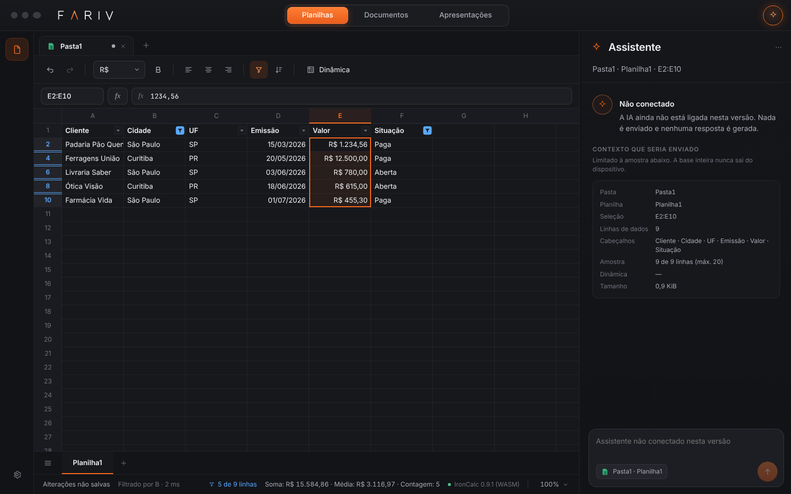
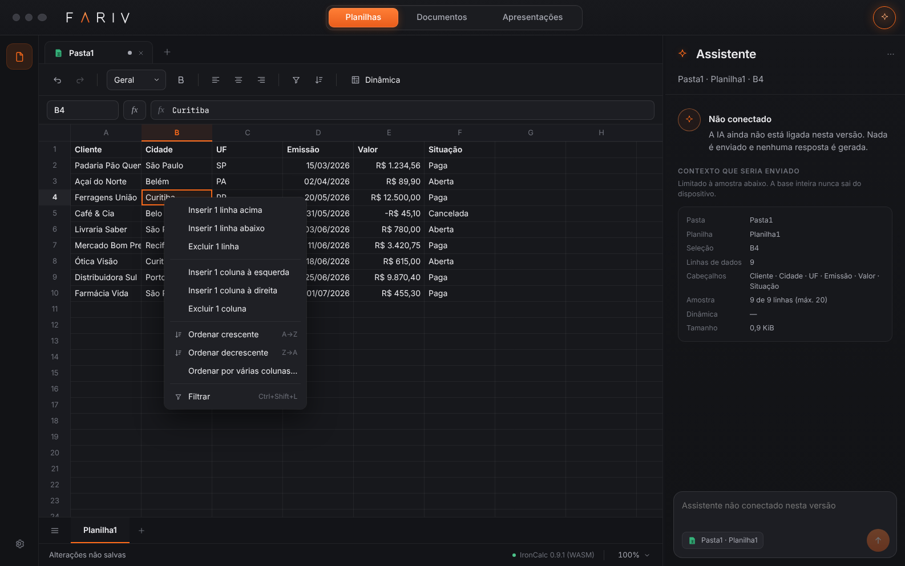

# Operações de tabela

Filtros, ordenação, inserir e excluir linhas e colunas, com desfazer e refazer, sobre o IronCalc 0.9.1, que continua sendo a única fonte da verdade. Este documento descreve o comportamento, a API, como cada operação é feita, o que é gravado em `.farcel` e `.xlsx`, as medições e as limitações.

## Na interface

Ações perto da seleção, sem barra nova:

| Onde | O quê |
| --- | --- |
| Botão direito numa célula (ou tecla Menu) | Inserir N linhas acima/abaixo, excluir N linhas, inserir N colunas à esquerda/direita, excluir N colunas (N = linhas ou colunas da seleção), ordenar crescente/decrescente pela coluna da célula ativa, ordenar por várias colunas…, filtrar/remover filtro, reexibir linhas ocultas (quando a seleção tem). |
| Botão direito no cabeçalho de linha ou de coluna | Só as ações daquele eixo. Se a linha ou coluna clicada já está selecionada, vale a seleção inteira. |
| Botões do filtro (na linha de cabeçalho da tabela filtrada) | Classificar de A a Z / Z a A, busca, lista de valores com contagem (`(Vazias)` para células vazias), selecionar tudo, Aplicar, Remover filtro. Coluna com critério fica com o botão azul e o funil. |
| Barra de ferramentas | Dois ícones: filtro (liga e desliga, Ctrl+Shift+L) e ordenar (abre a caixa de ordenação). |
| Barra de status | “3 de 5 linhas” enquanto há filtro; soma, média e contagem da seleção ignoram linhas ocultas, como no Excel. |



| Menu da seleção | Lista de um filtro | Ordenar por várias colunas |
| --- | --- | --- |
|  |  |  |

Linhas ocultas somem da grade e deixam uma linha dupla azul no cabeçalho de linha, onde estavam. As linhas de uma tabela filtrada têm o número em azul. As setas, PageUp/PageDown e o clique pulam as linhas ocultas.

**Qual intervalo.** Com uma célula selecionada, filtro e ordenação usam a região atual (o bloco de células preenchidas em volta, como o Excel). Com várias células, usam a seleção. Se a seleção deixa de fora colunas vizinhas da mesma tabela, a ordenação pergunta: **Tabela inteira** (padrão, mantém os registros juntos), **Só a seleção** (troca só aquelas células, separando os registros) ou Cancelar. Dentro de uma tabela filtrada, a ordenação usa o intervalo do filtro, com cabeçalho.

**Cabeçalho.** Com filtro, a primeira linha do intervalo é sempre cabeçalho e fica no lugar. Na ordenação rápida, a primeira linha é tratada como cabeçalho quando é toda de texto e a linha de baixo tem número, data ou vazio, ou quando está em negrito (o palpite do Excel); a mensagem diz “cabeçalho mantido” ou “sem cabeçalho”, e a caixa de ordenação tem a opção para corrigir.

## API tipada

Tudo passa por três pedidos ao worker do motor (`src/engine/protocol.ts`), com os tipos em `src/core/table-ops.ts`. A interface usa exatamente esta API; a IA da próxima etapa usará a mesma.

```ts
type TableOperation =
  | { kind: 'insertRows' | 'deleteRows' | 'insertColumns' | 'deleteColumns'; sheet: number; at: number; count: number }
  | { kind: 'sort'; sheet: number; range: Rect; header: boolean; keys: { column: number; descending?: boolean }[] }
  | { kind: 'setFilter'; sheet: number; range: Rect; criteria: { column: number; mode: 'include' | 'exclude'; values: string[] }[] }
  | { kind: 'clearFilter'; sheet: number }
  | { kind: 'showRows'; sheet: number; top: number; bottom: number };

client.call('tableOp', { op, confirmed? })   // { done: true, ...MutationResult } | { done: false, cost: { cells, seconds } }
client.call('tableQuery', { kind: 'region', sheet, cell })                         // { kind: 'region', rect }
client.call('tableQuery', { kind: 'filterValues', sheet, column, search?, limit? }) // valores distintos, contagem, selecionado
client.call('rowLayout', { sheet })            // { hidden: Int32Array de pares (início, fim), filter, layoutVersion }
```

- Colunas e linhas são números a partir de 1, como no motor. `range.top` de um filtro é a linha de cabeçalho.
- Cada `tableOp` é **um passo** de desfazer. `undo`/`redo` são os mesmos de sempre.
- Os valores de filtro são o **texto exibido** (`"1.234,50"`, `"05/01/2026"`, `"VERDADEIRO"`), e `""` representa células vazias. Critérios de colunas diferentes se somam (E).
- Inserção ou exclusão que o IronCalc faria célula a célula por mais de 3 s não começa: volta `done: false` com a estimativa, e só roda com `confirmed: true`. A interface pergunta; a IA terá de perguntar também.
- Erros vêm como mensagem em português e nada muda: ordenar intervalo com células mescladas ou fórmulas matriciais, critério fora do intervalo, quantidade inválida.
- `WorkbookInfo` ganhou `layoutVersion` (muda quando linhas aparecem ou somem), `filtered` (planilhas com filtro) e `historyTrimmed`.

## Como cada operação é feita

O IronCalc segue sendo o dono dos dados: nenhuma operação guarda cópia paralela das células, e todo valor exibido sai do modelo dele depois de recalcular.

| Operação | Execução | Por quê |
| --- | --- | --- |
| Inserir linhas/colunas | `insertRows`/`insertColumns` do IronCalc. | Ele atualiza as referências em todas as planilhas e o desfazer dele é correto. |
| Excluir linhas/colunas | O mesmo `deleteRows`/`deleteColumns`, numa **cópia** do modelo (`toBytes` → `fromBytes`); a cópia passa a ser a pasta e a anterior fica guardada para desfazer. | No IronCalc 0.9.1, desfazer uma exclusão deixa `#REF!` nas fórmulas que apontavam para as células excluídas (na mesma planilha e em outras). Trocando de modelo, desfazer devolve as fórmulas originais. |
| Ordenar | O `WorkbookEdit` (Rust, compilado com o mesmo IronCalc, em `native/xlsx-bridge/src/edit.rs`) lê os valores das colunas-chave, o JavaScript calcula a ordem, e o `WorkbookEdit` move as células nos dados do motor; o IronCalc carrega o resultado e recalcula. | Ordenar pelo próprio IronCalc só seria possível colando célula a célula: 409 s para 100 mil × 5 (medido). |
| Filtrar, remover filtro, reexibir | O `WorkbookEdit` marca as linhas ocultas de uma vez; o IronCalc carrega e recalcula. | `set_rows_hidden` do IronCalc percorre a lista de linhas para cada linha: quadrático (7,2 s para ocultar 16 mil trechos em 100 mil linhas; 10,5 s para reexibir todas). |

As linhas ocultas ficam **no modelo** (a mesma marca que vem de um XLSX), então o motor, o `.farcel` e o XLSX concordam. O filtro (intervalo e critérios) fica no worker, ao lado do modelo, e vai para o cabeçalho do `.farcel`.

### Desfazer e memória

Cada operação feita por troca de modelo guarda o modelo anterior inteiro, com o histórico dele; por isso dá para desfazer a operação **e** as edições feitas antes dela. São guardados até 4 modelos anteriores, ou 1 quando a pasta passa de 4 MiB serializada (bases grandes: cada cópia de 1 milhão de linhas ocupa centenas de MiB). Ao passar do limite, os passos mais antigos são descartados e a interface avisa uma vez: “as ações mais antigas desta pasta não podem mais ser desfeitas”. Desfazer e refazer de uma troca são instantâneos (troca de ponteiro).

## Semântica

### Ordenação

- Registros inteiros: cada linha do intervalo se move com valores, fórmulas, estilos, hiperlinks e comentários. Linhas ocultas viajam com o registro (o filtro continua valendo). Alturas de linha ficam com o número da linha.
- Ordem crescente: números e datas (datas são números), depois texto (sem diferenciar maiúsculas; acentos depois da letra sem acento, `pt-BR`), depois VERDADEIRO/FALSO, depois erros. Decrescente inverte. **Vazias sempre por último**, nas duas direções. Uma fórmula que devolve `""` conta como vazia. Iguais mantêm a ordem (estável). Várias chaves: a segunda desempata a primeira, e assim por diante.
- O valor comparado é o resultado guardado no motor (o mesmo que a grade mostra), não o texto formatado: `9` vem antes de `10`.
- **Fórmulas** — comportamento do Excel, conferido com o motor nos testes (`tests/table.test.ts`):
  - referência relativa na mesma linha continua apontando para a própria linha: `=B2*C2` levada para a linha 5 vira `=B5*C5`;
  - referência à linha de cima continua apontando **uma linha acima** da nova posição: um acumulado `=D2+B3` levado para a linha 2 vira `=D1+B2` e, se D1 é o cabeçalho, dá `#VALOR!`. Ordenar uma coluna de acumulado não mantém o acumulado; é o que o Excel também faz. Não transformamos fórmulas em valores;
  - referências absolutas (`$F$1`) não mudam;
  - fórmulas **fora** do intervalo (inclusive em outras planilhas) que apontam para dentro dele continuam apontando para a mesma **célula**, não para o mesmo registro: `=Planilha1!B2` passa a mostrar o que ficou em B2.
- Recusado, sem mudar nada: intervalo com células mescladas, ou com fórmulas matriciais/derramadas.

### Filtros

- Um filtro por planilha. O intervalo começa na linha de cabeçalho; os critérios valem para as linhas de dados.
- O valor comparado é o texto exibido, como no Excel (uma data filtra por `05/01/2026`, um número pelo formato da célula).
- A lista de valores mostra até 1.000 valores distintos, em ordem natural (`2` antes de `10`), com `(Vazias)` por último; a busca ignora maiúsculas e acentos. Com mais valores, a lista avisa e a busca encontra o resto. Com busca, Aplicar mostra só os resultados marcados (como o Excel). Sem busca, guarda o menor dos dois conjuntos (incluir os marcados ou excluir os desmarcados).
- Com linhas ocultas na seleção: **copiar** leva só as visíveis (e cola como valores); **Delete** limpa só as visíveis; a soma da barra de status ignora as ocultas. Excluir linhas fica desabilitado quando a seleção tem linhas ocultas (o Excel exclui só as visíveis; aqui, para não apagar dados ocultos sem querer, é preciso remover o filtro antes). Formatação (negrito, alinhamento, formato de número) e colar ainda atingem as ocultas também.
- Editar uma célula não reaplica o filtro (como o Excel): reabra o botão e aplique de novo.

### Inserir e excluir

- Referências são atualizadas pelo IronCalc em **todas** as planilhas: inserir linhas dentro de `=SOMA(Planilha1!E2:E6)` vira `E2:E8`; excluir parte do intervalo encolhe; excluir a célula referenciada dá `#REF!`, e desfazer devolve a fórmula original.
- Inserir logo abaixo do fim de um intervalo não o estende (como no Excel).
- O filtro acompanha: inserir acima move o intervalo, inserir dentro o aumenta, excluir a linha de cabeçalho remove o filtro, excluir uma coluna remove o critério dela.
- Operações em linhas ou colunas inteiras são limitadas ao que existe: com colunas inteiras selecionadas, inserir/excluir linhas fica desabilitado (seriam 1.048.576 linhas).

### Dinâmicas e gráficos

**Decisão: a tabela dinâmica usa a base inteira**, inclusive as linhas ocultas por filtro. A dinâmica tem os filtros dela; o filtro da grade serve para olhar e editar os dados. Isso vale também para o Excel com tabelas dinâmicas (o filtro da planilha de origem não muda a dinâmica). Quando a planilha de origem tem filtro, a linha “Origem” da dinâmica diz “base inteira, inclusive linhas ocultas pelo filtro”.

Toda operação de tabela invalida a extração da dinâmica (as linhas mudaram de lugar ou de número) e a dinâmica visível é recalculada; o gráfico segue a dinâmica. Testado: totais iguais depois de filtrar e de ordenar; atualizados depois de inserir um registro, excluir outro e desfazer.

## Arquivos

| | `.farcel` | `.xlsx` |
| --- | --- | --- |
| Linhas ocultas (por filtro ou não) | sim (no modelo) | sim (`hidden="1"`) |
| Filtro: intervalo e critérios | sim (cabeçalho, `app.filters`) | **não** — salvar avisa: “O filtro de 1 planilha (botões e critérios): o XLSX guarda as linhas que ele ocultou, que continuam ocultas, mas não o filtro; só o .farcel.” A pasta continua marcada como não salva, como acontece com as dinâmicas. |
| Ordem dos registros, fórmulas, estilos depois de ordenar | sim | sim |

Ao abrir um XLSX com linhas ocultas (inclusive por um filtro do Excel), elas aparecem ocultas e marcadas na grade; “Reexibir linhas ocultas” no menu da seleção mostra de novo. A definição do filtro do Excel não é importada (está no relatório de importação).

## Medições

Base sintética (planilha Dados com cabeçalho e 5 colunas: Região, Canal, Categoria, Quantidade, Receita; planilha Resumo com 3 fórmulas de agregação sobre Dados). Uma execução por tamanho, em processo próprio. Arquivos completos: `docs/results/table-node-*.json` e `docs/results/table-browser-*.json`.

**Ambiente:** contêiner Linux 6.18 x64, Intel Xeon 2,8 GHz, 4 CPUs lógicas, 16 GiB; Node 22.22; Chromium 153 headless (Playwright), build de produção servido pelo `vite preview`. Não é Windows nem o executável; não são arquivos reais.

### Node — só o motor (`npm run bench:table -- <linhas>`)

`WorkbookEngine.apply` direto, sem worker nem grade, com o mesmo WASM do navegador. O filtro “Sul” oculta ~80% das linhas em ~16 mil (100 mil) e ~160 mil (1 milhão) trechos separados. “1ª” inclui o crescimento da memória WASM para a cópia do modelo; “de novo” é a mesma operação depois (as ordenações em sentido oposto, para não repetir uma ordem já pronta).

| Operação | 100 mil linhas | 1 milhão de linhas |
| --- | --- | --- |
| Ligar o filtro (sem critério) | 3 ms | 7 ms |
| Lista de valores de Região (5 valores) | 0,17 s | 1,2 s |
| Lista de valores de Receita (≈ todos distintos) | 1,0 s | 6,2 s |
| Filtrar Região = Sul — 1ª / de novo | 0,48 / 0,35 s | 4,9 / 3,2 s |
| Filtrar Região ≠ Sul e Canal = Atacado — 1ª / de novo | 0,62 / 0,51 s | 5,9 / 4,8 s |
| Remover o filtro (mostrar tudo) | 0,16–0,18 s | 1,6 s |
| Ordenar por Receita — 1ª / de novo | 0,42 / 0,40 s | 4,5 / 2,8 s |
| Ordenar por Região, Canal, Receita — 1ª / de novo | 0,44 / 0,50 s | 5,6 / 5,4 s |
| Desfazer / refazer filtro ou ordenação | < 1 ms | < 1 ms |
| Inserir 10 linhas depois dos dados | 0,20 s | 2,2 s |
| Inserir 1 linha abaixo do cabeçalho (move tudo) | 1,4 s | 15,8 s (estimativa do app: 20 s) |
| Excluir essa linha (cópia + exclusão) | 1,5 s | 34,1 s (estimativa: 40 s) |
| Memória WASM do motor: depois de gerar → depois das operações | 223 → 223 MiB | 593 → 927 MiB (1.314 MiB durante a exclusão) |
| Memória WASM do conversor (`WorkbookEdit`) | 53 MiB | 498 MiB |
| RSS do processo Node (máximo) | 0,53 GiB | 2,1 GiB |

Variação entre execuções: numa execução anterior idêntica em 1 milhão de linhas, os primeiros filtros levaram 10,6 s e 10,4 s, e a primeira ordenação 7,4 s (depois, 3,8 s e 4,0 s). O custo estável está na coluna “de novo”; a primeira operação grande pode custar o dobro.

Onde vai o tempo de um filtro em 1 milhão de linhas (medido à parte, em regime): ler a coluna do critério pelo IronCalc ~1,3 s; `toBytes` 0,4 s; decodificar no `WorkbookEdit` 0,15 s; marcar as linhas 0,35 s; codificar 0,2–0,5 s; `fromBytes` 0,15–2 s; recalcular a pasta 0,6 s.

### Navegador — pela interface (`npm run bench:table:browser -- <linhas>`)

Do comando (atalho, clique ou menu) até a grade desenhar o resultado (`data-settled`). “No worker” é o tempo da operação dentro do worker do motor. Memória: WASM do motor e RSS somado dos processos do Chromium (inclui o conversor, que fica no mesmo worker).

| Ação na interface | 100 mil: total (worker) | 1 milhão: total (worker) | 1 milhão: WASM do motor / Chromium |
| --- | --- | --- | --- |
| Ctrl+Shift+L (região atual + ligar filtro) | 0,16 s (3 ms) | 0,86 s (5 ms) | 593 MiB / 1,24 GiB |
| Abrir a lista de Região | 0,22 s | 1,3 s | 593 MiB / 1,23 GiB |
| Aplicar Região = Sul | 0,49 s (0,37 s) | 3,1 s (2,9 s) | 648 MiB / 1,77 GiB |
| 20 × PageDown sobre as linhas filtradas | 0,20 s | 0,97 s | 648 MiB / 1,79 GiB |
| Ctrl+Shift+L (remover filtro) | 0,18 s (0,15 s) | 3,6 s (3,2 s) | 897 MiB / 2,05 GiB |
| Ordenar Receita decrescente (menu da célula) | 0,59 s (0,41 s) | 6,2 s (5,5 s) | 897 MiB / 2,02 GiB |
| Ctrl+Z da ordenação | 0,06 s | 0,03 s | 897 MiB / 2,02 GiB |
| Ordenar Região, Canal (caixa, dois níveis) | 0,81 s (0,44 s) | 5,9 s (4,8 s) | 897 MiB / 2,04 GiB |

Durante essas operações a thread da interface continua livre (rolar e abrir menus respondem; células que ainda não estavam carregadas só aparecem quando o worker termina). A pasta mostra a operação em andamento (“Ordenado…”, “Filtrado…”) e recusa edições até o worker responder.

## Limitações conhecidas

- **Uma tabela filtrada por planilha.** Ligar o filtro em outra tabela da mesma planilha troca o filtro.
- **Critérios só por lista de valores.** Não há “maior que”, “contém”, “entre datas”, top 10, cor. Os valores comparados são o texto exibido: mudar o formato de número de uma coluna muda o texto e o critério deixa de casar.
- **O filtro não se reaplica sozinho** depois de editar, colar ou inserir (como no Excel); reabra o botão e aplique.
- **Lista de valores limitada a 1.000 itens** (a busca encontra os demais). Montar a lista lê a coluna inteira célula a célula: ~1,5 s para Região e ~7 s para Receita (1 milhão de valores distintos) em 1 milhão de linhas.
- **Em 1 milhão de linhas, filtrar e ordenar levam segundos** (tabela de medições). A interface não trava (o trabalho é no worker), mas a pasta fica ocupada e não aceita edições até terminar. A primeira operação grande da sessão é a mais lenta, porque a memória WASM cresce para caber a cópia do modelo.
- **Inserir/excluir perto do topo de uma base grande é lento**: o IronCalc move cada célula (medido ~3–4 µs por célula; ~18 s para inserir uma linha acima de 1 milhão × 5). Acima de 3 s estimados o app pede confirmação; não há como cancelar depois de começar. Inserir depois dos dados também custa (~2,6 s em 1 milhão de linhas, varredura do motor).
- **Memória**: cada operação que troca de modelo mantém o modelo anterior para desfazer. Em 1 milhão de linhas a memória WASM do motor foi de 593 MiB para ~900 MiB, e o conversor (outra instância WASM no mesmo worker) reserva ~500 MiB na primeira ordenação ou filtro. Pastas acima de 4 MiB serializadas guardam só 1 modelo anterior: depois de duas ordenações seguidas, a primeira não pode mais ser desfeita (o app avisa).
- **Ordenar recusa** células mescladas e fórmulas matriciais no intervalo. Não ordena colunas (da esquerda para a direita), nem por cor ou lista personalizada. A comparação de texto usa o `Intl.Collator` `pt-BR` do ambiente; o Excel usa a ordenação dele, que pode diferir em símbolos e pontuação.
- **Formatação e colar** numa seleção com linhas ocultas atingem as ocultas também; excluir linhas com ocultas na seleção fica desabilitado.
- **Células vazias criadas por colagem** (um campo vazio colado de outro programa) contam como preenchidas para a região atual, porque o IronCalc as guarda como células; a região pode passar por cima de uma linha que parece vazia.
- **XLSX**: o filtro (botões e critérios) não é gravado nem lido; as linhas ocultas são. Abrir um XLSX com filtro do Excel mostra as linhas ocultas marcadas, sem os botões.
- **Colunas ocultas** de um XLSX continuam aparecendo (guardadas e exportadas, não exibidas como ocultas).
- **Desfazer de inserção** usa o histórico do próprio IronCalc; desfazer de exclusão, ordenação e filtro troca o modelo inteiro. As edições feitas antes continuam desfazíveis, até o limite de memória acima.
- Medições só em Linux (contêiner, 4 CPUs), Node 22 e Chromium headless; nada medido em Windows nem com arquivos reais.
